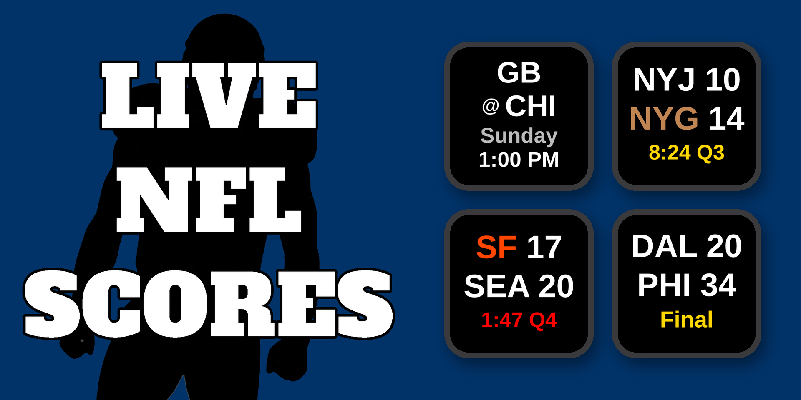
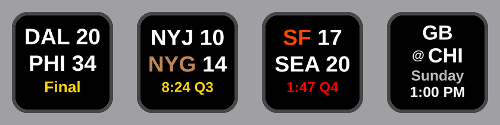
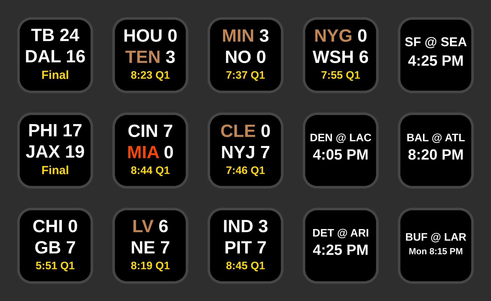

# Live NFL Scores — Stream Deck Plugin



A Stream Deck plugin that shows live NFL scores directly on your keys. Two actions: **Live NFL Scores** tracks one team per key, and **Live NFL Scoreboard** fills your keys with the whole week's games. Keys update automatically every 30 seconds.

  [](https://marketplace.elgato.com/product/live-nfl-scores-d082e710-07bc-4b5a-95dc-5e276515f937)

---

## Features

- **Live scores** — shows away score, home score, quarter, and game clock while a game is in progress
- **Possession indicator** — the team with the ball is shown in brown, turning orange if they're in the red zone
- **Two-minute warning** — the clock turns red during the final 2:00 of the 2nd and 4th quarters
- **Pre-game** — the two teams stacked (`DEN` over `@ KC`), then the kickoff day and time ("TBD" until the NFL sets it, e.g. Week 18 flex games). On game day it's just the teams and the kickoff time
- **Final scores** — shows the final score with a "Final" label, including OT labeling for overtime games
- **Score-change flash** — when a team scores, the key blinks in that team's primary color, then shows a short card with the team and the play (e.g. KC / TD +6, then XP +1 when the kick is good)
- **End-of-game fireworks** — a short celebratory animation in the winning team's colors plays when the game ends (skipped on a tie)
- **Gamecast shortcut** — press any key to open that game directly in ESPN Gamecast (the box score once the game is final)
- **Custom link** — optionally send key presses to a link of your choice (like a regional broadcast page) once the game has started, instead of Gamecast
- **Bye-week shortcut** — if your team has no game scheduled, pressing the key opens that team's full schedule on ESPN instead
- **No-flicker updates** — keys only redraw when the display actually changes
- **Multi-key support** — add as many team keys as you want, each refreshes independently
- **Custom background color** — set a per-key background color and opacity in the settings panel, handy for telling teams apart at a glance across multiple keys
- **Live NFL Scoreboard action** — a second action that lays out the whole week: each key is one game, in kickoff order (Thursday through Monday), with "+N more" on the last key if you run out of keys and "No Game" on any extra keys. The week stays up until Tuesday 3:00 AM ET, same as the team keys. Each Stream Deck gets its own board
- **All 32 NFL teams** across all 8 divisions (AFC East, North, South, West and NFC East, North, South, West)

---

## Recent Updates

**v1.1.1.0**
- Pregame keys are easier to read: the teams stack on two lines (away team on top, "@ home" below, with a small "@") and the day and time get their own lines. On game day the day line goes away and the start time is shown larger. Same on team keys and Scoreboard keys
- Games a week or more out show the date on the day line ("Sat 10/24"), with the time underneath
- Fixed: on Tuesday morning after the week flipped, a Monday night game showed its date instead of "Monday"
- Postponed and delayed games use the same stacked layout

**v1.1.0.0**
- New: **Live NFL Scoreboard** action — drag it onto as many keys as you like and they fill with this week's games (Thursday through Monday) in kickoff order, one game per key. Same keys as the team action: possession and red zone, score flash with TD/XP/FG/SAF/2PT cards, fireworks at the final. Fill top-to-bottom or left-to-right, optionally send finals to the end, and the last key shows "+N more" if the week has more games than keys. Each Stream Deck gets its own board
- Press a Scoreboard key to open that game in ESPN Gamecast (the box score once it's final); the "+N more" key opens ESPN's full NFL scoreboard
- Keys past the number of games this week show "No Game" (matches Live MLB Scoreboard); pressing one refreshes the board and opens ESPN's full NFL scoreboard
- 16 keys recommended: fits every game in any week
- Final games now open ESPN's box score instead of Gamecast, on both actions
- The board holds the week through Monday night and flips to next week at Tuesday 3:00 AM ET, the same rule the team keys use
- Pregame keys show "TBD" when the NFL hasn't set the kickoff time yet (e.g. Week 18 flex games), on both actions
- No fireworks when a game ends in a tie, on both actions
- Bye weeks now show `BYE WEEK` for the whole off week (Tuesday 3:00 AM ET to Tuesday 3:00 AM ET). Before, the key jumped ahead to the next game a week early
- A team whose season is over (e.g. knocked out of the playoffs while others play on) now shows `No Game` instead of `BYE WEEK`
- Neutral-site games (London and other international games, the Super Bowl) show `PHI vs JAX` instead of `PHI @ JAX`, on both actions

**v1.0.15.0**
- Score flash is now 5 solid blinks of the scoring team's color with no text, so it reads at a glance even on light team colors
- New: right after the flash, a 3-second card shows the scoring team and the play — TD +6, FG +3, SAF +2 (TD +7 / TD +8 if the try lands in the same update)
- New: when the extra point or two-point try comes in after a touchdown, a quick 2-second XP +1 / 2PT +2 card shows (no blinks)
- Settings help text now says "key" instead of "button"

Older updates: see the full version history in [CHANGELOG.md](CHANGELOG.md).

---

## Requirements

- [Elgato Stream Deck](https://www.elgato.com/stream-deck) hardware
- [Stream Deck software](https://www.elgato.com/downloads) version 6.9 or later (Mac or Windows)
- No account or API key required — the plugin uses ESPN's free public scoreboard API

---

## Installation

**Elgato Marketplace (recommended)**

1. Open **[Live NFL Scores on the Elgato Marketplace](https://marketplace.elgato.com/product/live-nfl-scores-d082e710-07bc-4b5a-95dc-5e276515f937)** and install it from there
2. The plugin will appear in the Stream Deck action picker under **Live NFL Scores**

**Manual install**

1. Download the latest **`Live NFL Scores.streamDeckPlugin`** from the [Releases](../../releases) page
2. Double-click the file — Stream Deck will install it automatically

---

## Setup

1. Drag the **Live NFL Scores** action onto any key
2. In the settings panel on the right, find your team by typing into the search box or by picking a division and then a team from the dropdowns
3. That's it — the key will load your team's current or upcoming game within a few seconds and refresh every 30 seconds from there

**Scoreboard:**

1. Drag the **Live NFL Scoreboard** action onto as many keys as you want. **16 keys is recommended**: that fits every game in any week (16 games when all 32 teams play)
2. Optionally, open the settings panel on any Scoreboard key to fill top-to-bottom or left-to-right, or to move finished games to the end. The setting applies to every Scoreboard key

---

## What the Key Shows



**Before the game** (later in the week; the day is gray):
```
DEN
@ KC
Sunday
1:00 PM
```

**Game day:**
```
DEN
@ KC
8:20 PM
```

**Live game:**
```
DEN    7
KC    17
Q3 8:42
```
The team with the ball is colored brown (orange in the red zone); the clock turns red during the two-minute warning.

**Final score:**
```
DEN    7
KC    24
 Final
```

**Bye week:**
```
 KC
BYE WEEK
```
Shown for the whole off week: from the Tuesday 3:00 AM ET after the team's last game until the Tuesday 3:00 AM ET that starts the week of its next game. Pressing the key in this state opens that team's schedule on ESPN.

**No game found at all** (e.g. deep off-season, or after your team's season ends):
```
 KC
No Game
```
Same key behavior as a bye — pressing it opens the team's schedule on ESPN.

---

## The Scoreboard



Each **Live NFL Scoreboard** key is one game from this week, in kickoff order (Thursday through Monday). The keys look and act just like the team keys above: possession and red zone colors, two-minute warning, the score flash and play card, and fireworks at the final.

- **More games than keys:** the last key shows `+N more`; pressing it opens ESPN's full NFL scoreboard
- **More keys than games:** the extra keys show `No Game`; pressing one refreshes the board and opens ESPN's full NFL scoreboard
- **Fill order:** top-to-bottom (default) or left-to-right, set in the settings panel
- **Finals last:** optionally move finished games to the end so live and upcoming games stay up front
- **Tip for smaller Stream Decks** (Mini, Neo, a 15-key MK.2): turn on finals last, so live and upcoming games keep their keys and finished games move to the `+N more` key.
- **Week change:** the board keeps this week up until Tuesday 3:00 AM ET, then moves to next week
- **Multiple Stream Decks:** each deck (including a Virtual Stream Deck or Stream Deck Mobile) gets its own board

---

## How It Works

The plugin polls [ESPN's public NFL scoreboard API](https://site.api.espn.com/apis/site/v2/sports/football/nfl/scoreboard) once every 30 seconds per key. No API key or account is required. The plugin is fully self-contained — it uses only Node.js built-in modules and requires no external dependencies.

Because NFL teams play roughly once per week rather than daily, the plugin queries a rolling 21-day window (ten days back, ten days ahead) and picks the most relevant game for your team: a game in progress takes priority over an upcoming game, which takes priority over last week's final — so the key holds onto a result until the next game appears on the schedule.

---

## Uninstalling

Open Stream Deck → Preferences → Plugins, select **Live NFL Scores**, and click the **−** key.

---

## Contributing

Bug reports and feature requests are welcome — open an [Issue](../../issues) to get started.

---

## Disclaimer

This plugin is not affiliated with, endorsed by, or sponsored by the NFL, ESPN, or any team. All data is sourced from ESPN's public scoreboard API and is subject to ESPN's terms of use. This plugin is intended for individual, personal, non-commercial use only.

---

## Credits

Created by **T.J. Lauerman aka ThatSportsGamer**

Created with Claude Cowork by Anthropic

Data provided by [ESPN](https://www.espn.com/nfl/)
